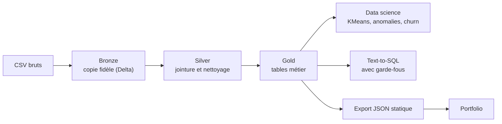

# Projet iGaming : du CSV brut à la décision business

**Auteur :** Olivier Vertu NDINGA OBA · **Stack :** Databricks (Delta, SQL, Unity Catalog), Python (pandas, scikit-learn, sqlglot), Gemini (Text-to-SQL), Next.js

## 1. Contexte et objectif

Un opérateur de jeux en ligne (slots) collecte trois flux : les joueurs, leurs sessions et chaque tour joué. Ces données brutes ne servent à rien tant qu'elles ne répondent pas à des questions de décision :

1. **Marketing** : quel canal d'acquisition rapporte le plus ?
2. **Valeur client** : qui sont les joueurs VIP, et lesquels risquent de partir ?
3. **Risque et conformité** : quelles sessions justifient une revue humaine ?
4. **Accessibilité** : comment un manager obtient-il une réponse sans écrire de SQL ?

Le projet construit le pipeline complet, des fichiers CSV aux réponses, en passant par la modélisation statistique.

## 2. Les données

| Table | Lignes | Contenu |
|---|---|---|
| `players` | 8 000 | pays, canal d'acquisition, appareil, système d'exploitation |
| `sessions` | 46 690 | durée, nombre de tours, mise moyenne et maximale, IP et appareil (hachés), incohérence de localisation |
| `spins` | 4 646 999 | mise, gain, volatilité de la machine, achat de bonus |

Période couverte : du 1er octobre 2025 au 29 janvier 2026. Les identifiants d'appareil et d'IP sont hachés. L'origine exacte du jeu de données n'a pas été vérifiée : les conclusions décrivent ces données, pas un opérateur réel.

## 3. Architecture



- **Bronze** : trois tables Delta chargées depuis un volume Unity Catalog, sans transformation. Le schéma est détecté automatiquement et aucune donnée n'est perdue (`_rescued_data` vide).
- **Silver** (`silver_player_activity`) : jointure joueur, session et tour, avec le revenu net par tour. Les 4 646 999 tours sont conservés : aucune mise nulle ou négative n'a été trouvée.
- **Gold** : quatre tables prêtes pour l'analyse (`gold_channel_performance`, `gold_player_value`, `gold_risk_sessions`, `gold_player_stats`).

Vocabulaire utile : le **revenu net (GGR)** est la différence entre les mises et les gains, soit l'argent gardé par le casino. Le **hold** est le GGR divisé par les mises. Le **RTP** est la part des mises reversée aux joueurs.

## 4. Résultats

**Vue d'ensemble** : 8,11 M de mises, 574 k de revenu net, RTP global de 92,9 %. Sur 8 000 inscrits, 6 857 ont joué.

### 4.1 Marketing : la valeur vient de la qualité, pas de la conversion

| Canal | Inscrits | Revenu net par inscrit | Hold |
|---|---|---|---|
| organic | 2 297 | **90,57** | 8,8 % |
| paid_social | 1 261 | 73,21 | 7,7 % |
| affiliate | 2 525 | 67,70 | 6,4 % |
| paid_search | 1 438 | 57,74 | 6,1 % |
| referral | 479 | 41,72 | 3,9 % |

L'activation est quasi identique entre canaux (85 à 86 %). L'écart de rentabilité vient donc de la **valeur des joueurs acquis**. `affiliate` apporte le plus de volume mais rapporte 25 % de moins par inscrit que `organic`. Le référencement (`referral`) est le canal le moins rentable. *Recommandation : comparer ces valeurs au coût d'acquisition de chaque canal avant de réallouer le budget. Ce coût n'est pas dans les données.*

### 4.2 Valeur client : une forte concentration

- Les **10 % de joueurs qui misent le plus** représentent **64 % des mises** ; les 20 % meilleurs, 79 %.
- Les **69 VIP** (1 % des joueurs actifs) génèrent **41 % du revenu net**.
- Les 1 743 « Champions » pèsent 39 % des mises.
- **413 joueurs à forte valeur sont en train de partir** (553 k de mises cumulées) : c'est la première cible d'une campagne de réactivation.
- **32,7 % des joueurs actifs sont gagnants nets** sur la période : le revenu du casino repose sur une minorité de joueurs fortement perdants, ce qui rend le revenu sensible à l'évolution de quelques comptes.

Segmentation comportementale (KMeans, 4 groupes) : un groupe de 780 joueurs (11 %) produit 42 % du revenu net, un groupe de 1 247 joueurs aux mises élevées en produit 46 %, et 34 % des joueurs ne produisent que 2 %.

### 4.3 Risque : des signaux rares, donc exploitables

Le seuil naïf « session de plus de 10 h » ne détecte rien : la session la plus longue dure 1,5 h. Le score de risque repose donc sur des seuils tirés des données (99e percentile de durée, de rythme et de mise maximale), l'incohérence de localisation, et le partage d'appareil ou d'IP entre joueurs.

| Niveau | Sessions | Joueurs |
|---|---|---|
| High | 10 | 10 |
| Medium | 389 | 213 |
| Low | 6 072 | 2 166 |
| None | 40 219 | 6 395 |

Une détection par IsolationForest identifie 467 sessions atypiques. Seules **67** sont aussi marquées par les règles : les deux approches sont **complémentaires**, aucune ne remplace l'autre. Ce score est un outil de **priorisation pour une revue humaine**, pas une preuve de fraude.

### 4.4 Prédiction du départ (churn)

Un modèle de régression logistique prédit l'inactivité sur les 30 derniers jours à partir du comportement antérieur (6 443 joueurs, 33,6 % inactifs). **AUC = 0,75** sur un jeu de test séparé. Le facteur le plus protecteur est le **nombre de jours actifs** : la régularité compte plus que le montant misé. Le modèle est volontairement simple et sert de base de comparaison, pas de modèle de production.

### 4.5 Points à investiguer

- **Le hold baisse** : 9,6 % en novembre, 7,5 % en décembre, 6,0 % en janvier, alors que les mises restent stables (2,3 M par mois). Octobre est un mois de montée en charge (3 251 joueurs actifs contre 4 823 en novembre). La cause (chance des VIP, mix de machines, évolution du comportement) n'est pas établie.
- **Machines à faible volatilité** : elles ont un hold de 8,8 % contre 5,7 % pour la volatilité moyenne. Cela peut refléter un RTP différent par machine ou un effet de mix de joueurs.

## 5. Text-to-SQL avec garde-fous

Un manager pose une question en langage naturel. Un LLM traduit la question en SQL à partir du **schéma uniquement** (jamais des données). La requête est ensuite validée avant d'être exécutée sur Databricks.

Garde-fous implémentés (`text2sql.py`) :
- une seule instruction `SELECT`, aucune écriture ;
- seules les tables Gold sont accessibles (pas la couche brute, pas le schéma système) ;
- toute colonne inexistante est rejetée : une hallucination produit un refus explicite, pas une fausse réponse ;
- `LIMIT 100` imposé si absent ; tables qualifiées automatiquement.

**Évaluation** (`eval_text2sql.py`) :

| Test | Résultat | Portée |
|---|---|---|
| 14 tests de garde-fous (colonnes inventées, `DROP`, `DELETE`, requêtes multiples, schémas interdits…) | **14 / 14** | Mesure réelle, sans LLM |
| 15 questions, comparaison des résultats avec une requête de référence | 15 / 15 en mode hors ligne | Valide le pipeline de bout en bout. **Ne mesure pas la qualité d'un LLM** : le mode hors ligne renvoie la requête connue |

La précision réelle du modèle sera mesurée avec une clé Gemini : `GEMINI_API_KEY=... python eval_text2sql.py --live`. En production, une couche supplémentaire s'impose : un accès Databricks en lecture seule restreint aux tables Gold.

## 6. Limites

- Données d'origine non vérifiée et période de 4 mois : pas de saisonnalité annuelle.
- Pas de coût d'acquisition, donc pas de rentabilité nette par canal.
- Le revenu net est très concentré : les résultats par joueur sont instables.
- Le score de risque combine des signaux simples non validés par des cas confirmés de fraude.
- Le modèle de churn est une base de référence (AUC 0,75), sans optimisation.
- Le Text-to-SQL n'a pas encore été évalué avec un LLM réel.

## 7. Pistes d'amélioration

1. Évaluer le Text-to-SQL avec Gemini et mesurer le taux d'hallucination réel.
2. Ajouter les coûts d'acquisition pour calculer le retour sur investissement par canal.
3. Automatiser le pipeline avec un job Databricks planifié.
4. Tester des modèles de churn plus riches (arbres boostés) et comparer à la base de référence.
5. Valider le score de risque avec des cas étiquetés par une équipe conformité.

## 8. Industrialisation (CI/CD) et reproduction

Le pipeline est un **job Databricks défini en code** (Declarative Automation Bundles) : Bronze, puis un contrôle qualité, Silver, un contrôle, Gold, un contrôle. Un contrôle est un fichier SQL avec `assert_true` : une règle violée fait échouer la tâche et la couche suivante ne s'exécute pas. Les contrôles vérifient l'unicité des clés, qu'aucun tour n'est perdu entre les couches, et que revenu et mises se réconcilient entre Silver et Gold.

Deux environnements : `dev` (5 % des joueurs, exécution en environ une minute) et `prod` (toutes les données, environ 1 min 15 s).

```bash
make hooks         # exécute make check avant chaque git push
make check         # tests unitaires + validation du bundle (CI locale)
make test-dev      # déploie en dev et exécute sur l'échantillon
make deploy-prod   # check, puis déploiement en prod
make run-prod      # exécute le job de production
```

La CI est un hook Git local, pas un service hébergé : elle ne protège que si le hook est activé. Un test de câblage simule la synchronisation et échoue si un fichier nécessaire au job n'est pas envoyé sur Databricks : une exclusion de synchronisation avait justement supprimé les contrôles qualité et fait échouer le job.

Les scripts d'analyse (`datascience.py`, `export_portfolio.py`, `eval_text2sql.py`) se lancent à part. L'authentification passe par le CLI Databricks (OAuth) : aucun identifiant n'est stocké dans le projet.
