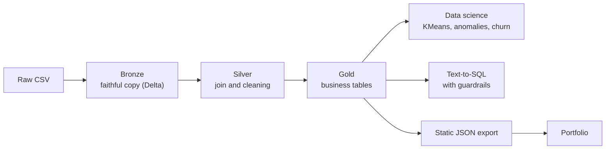

# iGaming Project: from raw CSV to business decisions

**Author:** Olivier Vertu NDINGA OBA · **Stack:** Databricks (Delta, SQL, Unity Catalog), Python (pandas, scikit-learn, sqlglot), Gemini (Text-to-SQL), Next.js

## 1. Context and goal

An online slots operator collects three streams: players, their sessions, and every spin. Raw data is only useful once it answers decision questions:

1. **Marketing:** which acquisition channel is the most profitable?
2. **Customer value:** who are the VIPs, and which valuable players are about to leave?
3. **Risk and compliance:** which sessions deserve a human review?
4. **Accessibility:** how can a manager get an answer without writing SQL?

The project builds the full pipeline, from CSV files to answers, including statistical modelling.

## 2. Data

| Table | Rows | Content |
|---|---|---|
| `players` | 8,000 | country, acquisition channel, device, operating system |
| `sessions` | 46,690 | duration, spin count, average and maximum bet, hashed IP and device, geo mismatch |
| `spins` | 4,646,999 | bet, win, slot volatility, bonus feature purchase |

Period covered: 1 October 2025 to 29 January 2026. Device and IP identifiers are hashed. The exact origin of the dataset has not been verified: conclusions describe this data, not a real operator.

## 3. Architecture



- **Bronze:** three Delta tables loaded from a Unity Catalog volume with no transformation. The schema is auto-detected and nothing is lost (`_rescued_data` is empty).
- **Silver** (`silver_player_activity`): player, session and spin joined, with net revenue per spin. All 4,646,999 spins are kept: no null or negative bet was found.
- **Gold:** four analysis-ready tables (`gold_channel_performance`, `gold_player_value`, `gold_risk_sessions`, `gold_player_stats`).

Glossary: **GGR** (gross gaming revenue) is bets minus wins, the money the casino keeps. **Hold** is GGR divided by turnover. **RTP** is the share of bets paid back to players.

## 4. Results

**Overview:** 8.11 M turnover, 574 k GGR, global RTP of 92.9%. Of 8,000 registered players, 6,857 played.

### 4.1 Marketing: value comes from quality, not conversion

| Channel | Registered | GGR per registered player | Hold |
|---|---|---|---|
| organic | 2,297 | **90.57** | 8.8% |
| paid_social | 1,261 | 73.21 | 7.7% |
| affiliate | 2,525 | 67.70 | 6.4% |
| paid_search | 1,438 | 57.74 | 6.1% |
| referral | 479 | 41.72 | 3.9% |

Activation is almost identical across channels (85 to 86%). The profitability gap therefore comes from **the value of the players acquired**. `affiliate` brings the most volume but earns 25% less per registered player than `organic`. `referral` is the least profitable channel. *Recommendation: compare these values with each channel's acquisition cost before reallocating budget. That cost is not in the data.*

### 4.2 Customer value: strong concentration

- The **top 10% of players by turnover** account for **64% of all bets**; the top 20% account for 79%.
- The **69 VIPs** (1% of active players) generate **41% of GGR**.
- The 1,743 "Champions" account for 39% of turnover.
- **413 high-value players are drifting away** (553 k cumulative turnover): the first target for a reactivation campaign.
- **32.7% of active players are net winners** over the period: casino revenue rests on a minority of heavy net losers, which makes revenue sensitive to the evolution of a few accounts.

Behavioural segmentation (KMeans, 4 groups): a group of 780 players (11%) produces 42% of GGR, a group of 1,247 high-stake players produces 46%, and 34% of players produce only 2%.

### 4.3 Risk: rare signals, therefore actionable

The naive "session longer than 10 h" rule detects nothing: the longest session lasts 1.5 h. The risk score therefore relies on thresholds derived from the data (99th percentile of duration, pace and maximum bet), geo mismatch, and devices or IPs shared between players.

| Level | Sessions | Players |
|---|---|---|
| High | 10 | 10 |
| Medium | 389 | 213 |
| Low | 6,072 | 2,166 |
| None | 40,219 | 6,395 |

An IsolationForest flags 467 atypical sessions. Only **67** are also flagged by the rules: the two approaches are **complementary**, neither replaces the other. This score is a **prioritisation tool for human review**, not proof of fraud.

### 4.4 Churn prediction

A logistic regression predicts inactivity over the last 30 days from earlier behaviour (6,443 players, 33.6% inactive). **AUC = 0.75** on a held-out test set. The most protective factor is the **number of active days**: regularity matters more than the amount wagered. The model is deliberately simple and serves as a baseline, not a production model.

### 4.5 Points to investigate

- **Hold is declining:** 9.6% in November, 7.5% in December, 6.0% in January, while turnover stays stable (2.3 M per month). October is a ramp-up month (3,251 active players versus 4,823 in November). The cause (VIP variance, slot mix, behaviour change) is not established.
- **Low-volatility slots:** hold of 8.8% versus 5.7% for medium volatility. This may reflect a different RTP per slot or a player-mix effect.

## 5. Text-to-SQL with guardrails

A manager asks a question in natural language. An LLM translates it to SQL from the **schema only** (never the data). The query is then validated before running on Databricks.

Guardrails implemented (`text2sql.py`):
- a single read-only `SELECT`;
- only Gold tables are reachable (no raw layer, no system schema);
- any non-existent column is rejected: a hallucination yields an explicit refusal, not a wrong answer;
- `LIMIT 100` enforced when missing; tables are fully qualified automatically.

**Evaluation** (`eval_text2sql.py`):

| Test | Result | Scope |
|---|---|---|
| 14 guardrail tests (invented columns, `DROP`, `DELETE`, multi-statements, forbidden schemas…) | **14 / 14** | Real measurement, no LLM involved |
| 15 questions, results compared with a reference query | 15 / 15 in offline mode | Validates the pipeline end to end. **Does not measure LLM quality**: offline mode returns the known query |

Real model accuracy will be measured with a Gemini key: `GEMINI_API_KEY=... python eval_text2sql.py --live`. In production, an extra layer is required: read-only Databricks access restricted to the Gold tables.

## 6. Limitations

- Unverified data origin and a 4-month period: no yearly seasonality.
- No acquisition cost, hence no net profitability per channel.
- GGR is highly concentrated: per-player results are unstable.
- The risk score combines simple signals not validated against confirmed fraud cases.
- The churn model is an unoptimised baseline (AUC 0.75).
- Text-to-SQL has not yet been evaluated with a real LLM.

## 7. Next steps

1. Evaluate Text-to-SQL with Gemini and measure the real hallucination rate.
2. Add acquisition costs to compute return on investment per channel.
3. Automate the pipeline with a scheduled Databricks job.
4. Try richer churn models (gradient boosting) and compare with the baseline.
5. Validate the risk score with cases labelled by a compliance team.

## 8. Industrialisation (CI/CD) and reproduction

The pipeline is a **Databricks job defined as code** (Declarative Automation Bundles): Bronze, a quality gate, Silver, a gate, Gold, a gate. A gate is a SQL file using `assert_true`: a violated rule fails the task and the next layer never runs. Gates check key uniqueness, that no spin is lost between layers, and that revenue and turnover reconcile between Silver and Gold.

Two environments: `dev` (5% of players, runs in about a minute) and `prod` (all data, about 1 min 15 s).

```bash
make hooks         # run make check before every git push
make check         # unit tests + bundle validation (local CI)
make test-dev      # deploy to dev and run on the sample
make deploy-prod   # check, then deploy to prod
make run-prod      # run the production job
```

CI is a local Git hook, not a hosted service: it only protects when the hook is enabled. A wiring test dry-runs the sync and fails if a file the job needs would not be uploaded to Databricks: a sync exclusion had silently dropped the quality gates and made the job fail.

The analysis scripts (`datascience.py`, `export_portfolio.py`, `eval_text2sql.py`) run separately. Authentication goes through the Databricks CLI (OAuth): no credential is stored in the project.
